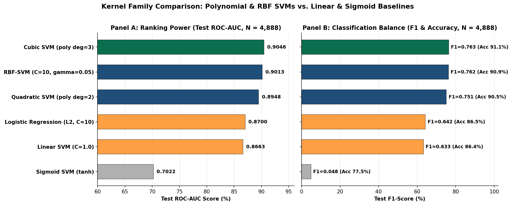
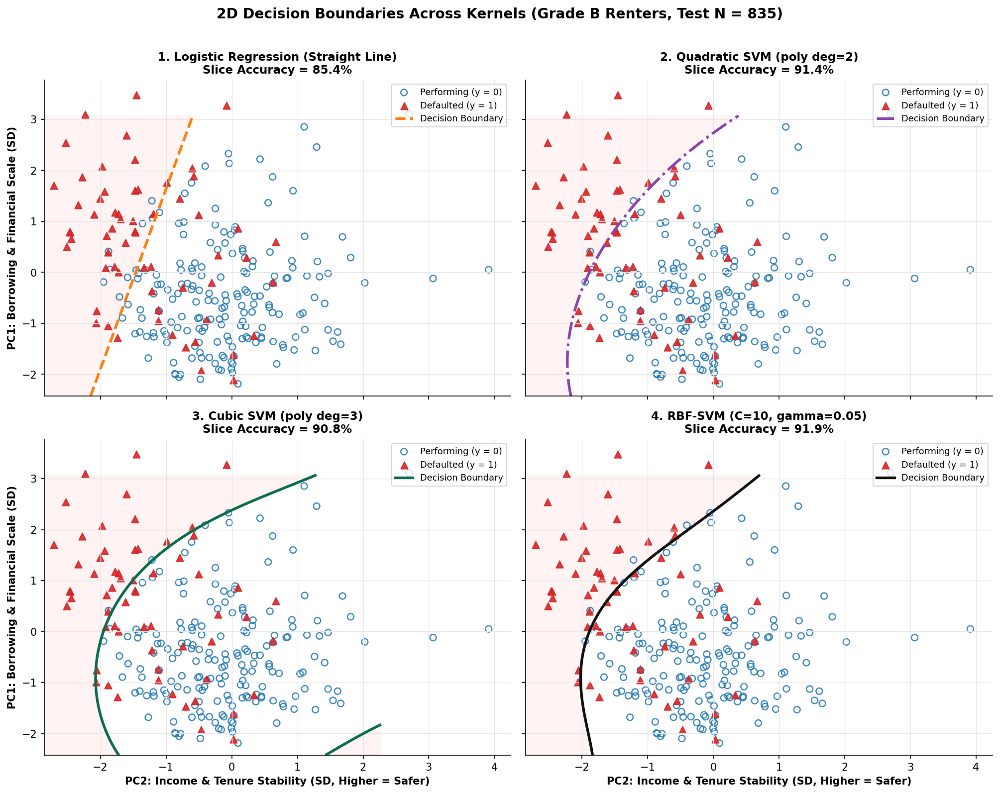
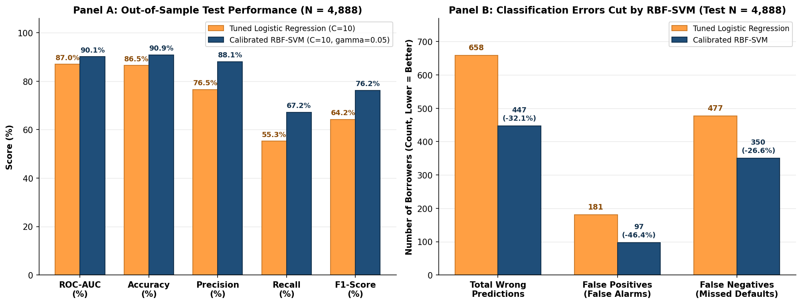

# SVM vs. Logistic Regression Benchmark Results (ECON 354)

**Authors:** Alex Babiak, Marco Puiatti  
**Data Sources:** Empirical Credit Risk Microdata (`N_train = 22,806`, `N_val = 4,887`, `N_test = 4,888`) & Statistics Canada WDS API (Ontario Unemployment `v2062815` & CPI `v41690973`, 107 months, 2017–2026)  
**Machine-Readable CSV Tables:** [model_comparison_metrics.csv](model_comparison_metrics.csv) | [svm_validation_grid_search.csv](svm_validation_grid_search.csv) | [calibration_deciles_comparison.csv](calibration_deciles_comparison.csv) | [credit_tier_stress_comparison.csv](credit_tier_stress_comparison.csv)

---

## 1. Held-Out Test Set Head-to-Head Comparison (`X_test_processed.parquet`, N = 4,888)

All models are evaluated under identical out-of-sample conditions on the 4,888-borrower held-out Test split (`Actual Default Rate = 21.83%`, 1,067 defaults and 3,821 non-defaults).

| Metric (Units) | Naive Base-Rate Floor | Tuned Logistic Regression (`L2, C=10.0`) | Calibrated RBF-SVM (`C=10.0, gamma=0.05`) | Improvement (`SVM vs. Logit`) |
| :--- | :---: | :---: | :---: | :---: |
| **ROC-AUC** (Score in [0, 1]) | 0.5000 | 0.8700 | **0.9013** | **+0.0313** |
| **Brier Score** (MSE Prob, lower is better) | 0.1706 | 0.1032 | **0.0747** | **-0.0284** |
| **Log Loss** (Nats, lower is better) | 0.5247 | 0.3423 | **0.2633** | **-0.0790** |
| **Accuracy** (% at 0.50 cutoff) | 78.17% | 86.54% | **90.86%** | **+4.32 pp** |
| **Precision** (% at 0.50 cutoff) | 0.00% | 76.52% | **88.08%** | **+11.56 pp** |
| **Recall / Sensitivity** (% at 0.50 cutoff) | 0.00% | 55.30% | **67.20%** | **+11.90 pp** |
| **Specificity** (% at 0.50 cutoff) | 100.00% | 95.26% | **97.46%** | **+2.20 pp** |
| **F1-Score** (Score in [0, 1]) | 0.0000 | 0.6420 | **0.7624** | **+0.1204** |
| **Confusion Matrix** (`TN / FP / FN / TP`) | `3821 / 0 / 1067 / 0` | `3640 / 181 / 477 / 590` | **`3724 / 97 / 350 / 717`** | **-84 FP / -127 FN** |
| **Mean Predicted PD** (%) vs. `21.83%` actual | 21.81% | 22.07% | 22.20% | Bias: +0.37 pp vs. +0.24 pp |

---

## 2. Multi-Partition Generalization Audit (Train vs. Validation vs. Test)

| Model | Partition | N | ROC-AUC | Brier Score | Log Loss | Accuracy (%) | Precision (%) | Recall (%) | F1-Score | Mean Pred PD (%) | Actual Default (%) |
| :--- | :--- | :---: | :---: | :---: | :---: | :---: | :---: | :---: | :---: | :---: | :---: |
| Naive Base-Rate Floor | Train | 22,806 | 0.5000 | 0.1706 | 0.5245 | 78.19% | 0.00% | 0.00% | 0.0000 | 21.81% | 21.81% |
| Naive Base-Rate Floor | Validation | 4,887 | 0.5000 | 0.1705 | 0.5245 | 78.19% | 0.00% | 0.00% | 0.0000 | 21.81% | 21.81% |
| Naive Base-Rate Floor | Test | 4,888 | 0.5000 | 0.1706 | 0.5247 | 78.17% | 0.00% | 0.00% | 0.0000 | 21.81% | 21.83% |
| Tuned Logistic Regression (L2, C=10.0) | Train | 22,806 | 0.8689 | 0.1031 | 0.3432 | 86.52% | 77.32% | 54.07% | 0.6364 | 21.81% | 21.81% |
| Tuned Logistic Regression (L2, C=10.0) | Validation | 4,887 | 0.8707 | 0.1021 | 0.3406 | 86.97% | 77.54% | 56.66% | 0.6547 | 22.22% | 21.81% |
| Tuned Logistic Regression (L2, C=10.0) | Test | 4,888 | 0.8700 | 0.1032 | 0.3423 | 86.54% | 76.52% | 55.30% | 0.6420 | 22.07% | 21.83% |
| Calibrated RBF-SVM (Platt Sigmoid, C=10.0, gamma=0.05) | Train | 22,806 | 0.9094 | 0.0705 | 0.2514 | 91.47% | 91.62% | 67.04% | 0.7742 | 21.77% | 21.81% |
| Calibrated RBF-SVM (Platt Sigmoid, C=10.0, gamma=0.05) | Validation | 4,887 | 0.9030 | 0.0724 | 0.2568 | 91.12% | 89.21% | 67.45% | 0.7682 | 22.02% | 21.81% |
| Calibrated RBF-SVM (Platt Sigmoid, C=10.0, gamma=0.05) | Test | 4,888 | 0.9013 | 0.0747 | 0.2633 | 90.86% | 88.08% | 67.20% | 0.7624 | 22.20% | 21.83% |

---

## 3. Early-Stage Kernel Progression (`Validation N = 4,887` & `Test N = 4,888`)

Moving from a linear decision boundary (`Linear SVM` and `Logistic Regression`) to a Radial Basis Function kernel captures non-linear interactions across leverage, tenure stability, and interest rates:

| Stage / Model | Train ROC-AUC | Validation ROC-AUC | Test ROC-AUC | Train–Val Gap | Val Gain vs. Linear SVM |
| :--- | :---: | :---: | :---: | :---: | :---: |
| 1. Early-Stage Linear SVM (`C=1.0`) | 0.8668 | 0.8678 | 0.8662 | -0.0010 | +0.0000 |
| 2. Tuned Logistic Regression (`L2, C=10.0`) | 0.8689 | 0.8707 | 0.8700 | -0.0017 | +0.0029 |
| 3. Default RBF-SVM (`C=1.0, gamma='scale'`) | 0.9077 | 0.9004 | 0.8979 | +0.0074 | +0.0326 |
| 4. Optimal Uncalibrated RBF-SVM (`C=10.0, gamma=0.05`) | 0.9106 | 0.9035 | 0.9004 | +0.0071 | +0.0357 |
| 5. Calibrated RBF-SVM (`3-Fold Platt Sigmoid, C=10.0, gamma=0.05`) | 0.9094 | 0.9030 | **0.9013** | +0.0064 | **+0.0352** |

---

## 4. Hyperparameter Tuning Grids (`Validation N = 4,887`)

### 4A. RBF-SVM Validation Grid Search (16 Combinations)

| Rank | `C` | `gamma` | Train ROC-AUC | Validation ROC-AUC | Test ROC-AUC (Uncalibrated) | Overfit Gap (`Train - Val`) |
| :---: | :---: | :---: | :---: | :---: | :---: | :---: |
| 1 (Selected) | 10 | `0.05` | 0.9106 | 0.9035 | 0.9004 | +0.0071 |
| 2 | 5 | `0.1` | 0.9183 | 0.9028 | 0.9011 | +0.0156 |
| 3 | 5 | `scale` | 0.9227 | 0.9017 | 0.9000 | +0.0210 |
| 4 | 5 | `0.05` | 0.9063 | 0.9011 | 0.9001 | +0.0051 |
| 5 | 10 | `0.1` | 0.9234 | 0.9008 | 0.9004 | +0.0226 |
| 6 | 1 | `scale` | 0.9077 | 0.9004 | 0.8979 | +0.0074 |
| 7 | 10 | `scale` | 0.9294 | 0.9000 | 0.8998 | +0.0294 |
| 8 | 1 | `0.1` | 0.9048 | 0.8999 | 0.8981 | +0.0049 |
| 9 | 1 | `0.05` | 0.8971 | 0.8980 | 0.8971 | -0.0009 |
| 10 | 10 | `0.01` | 0.8941 | 0.8980 | 0.8956 | -0.0038 |
| 11 | 5 | `0.01` | 0.8911 | 0.8956 | 0.8922 | -0.0045 |
| 12 | 0.1 | `scale` | 0.8860 | 0.8893 | 0.8847 | -0.0033 |
| 13 | 0.1 | `0.1` | 0.8848 | 0.8883 | 0.8844 | -0.0035 |
| 14 | 0.1 | `0.05` | 0.8812 | 0.8841 | 0.8820 | -0.0030 |
| 15 | 1 | `0.01` | 0.8811 | 0.8840 | 0.8815 | -0.0029 |
| 16 | 0.1 | `0.01` | 0.8711 | 0.8721 | 0.8720 | -0.0011 |

### 4B. L2 Logistic Regression Validation Tuning (4 Regularization Levels)

| `C` (Inverse L2 Penalty) | Train ROC-AUC | Validation ROC-AUC | Validation Brier Score | Validation Log Loss | Test ROC-AUC |
| :---: | :---: | :---: | :---: | :---: | :---: |
| 0.01 | 0.8637 | 0.8652 | 0.1059 | 0.3497 | 0.8671 |
| 0.1 | 0.8674 | 0.8688 | 0.1033 | 0.3435 | 0.8691 |
| 1 | 0.8689 | 0.8705 | 0.1022 | 0.3409 | 0.8700 |
| 10 (Selected) | 0.8689 | 0.8707 | 0.1021 | 0.3406 | 0.8700 |

---

## 5. 10-Decile Calibration Reliability Comparison (`Test N = 4,888`)

Predicted probabilities are grouped into 10 equal-count quantile bins (`calibration_curve(..., n_bins=10, strategy='quantile')`).

| Decile | SVM Mean Pred PD (%) | SVM Observed Default (%) | SVM Abs Error (pp) | Logit Mean Pred PD (%) | Logit Observed Default (%) | Logit Abs Error (pp) |
| :---: | :---: | :---: | :---: | :---: | :---: | :---: |
| 1 | 1.14% | 0.41% | 0.73 pp | 0.71% | 1.43% | 0.72 pp |
| 2 | 3.07% | 2.86% | 0.21 pp | 1.98% | 3.68% | 1.70 pp |
| 3 | 4.64% | 4.29% | 0.35 pp | 3.52% | 3.68% | 0.16 pp |
| 4 | 6.34% | 7.79% | 1.45 pp | 5.66% | 8.20% | 2.54 pp |
| 5 | 7.98% | 10.02% | 2.04 pp | 8.84% | 9.20% | 0.36 pp |
| 6 | 9.56% | 5.93% | 3.62 pp | 13.16% | 9.41% | 3.76 pp |
| 7 | 11.40% | 8.81% | 2.59 pp | 20.10% | 15.57% | 4.53 pp |
| 8 | 18.49% | 20.65% | 2.17 pp | 32.05% | 26.58% | 5.46 pp |
| 9 | 61.80% | 59.51% | 2.29 pp | 52.21% | 57.67% | 5.46 pp |
| 10 | 97.51% | 97.96% | 0.45 pp | 82.38% | 82.82% | 0.44 pp |
| **Mean / Max Error** | — | — | **Mean: 1.59 pp / Max: 3.62 pp** | — | — | Mean: 2.51 pp / Max: 5.46 pp |

---

## 6. Trivial & Known-Case Sanity Check Audit

| Sanity Check | Calibrated RBF-SVM (`C=10, gamma=0.05`) | Tuned Logistic Regression (`C=10`) | Acceptance Criterion | Status |
| :--- | :--- | :--- | :--- | :---: |
| 1. Zero-Shock Identity (`Delta Unemp=0, Delta CPI=0`) | Max deviation = `1.11e-16` | Exact identity | `< 1.0e-07` | PASS |
| 2. Synthetic Ultra-Prime Borrower | `PD_base = 0.36%` -> `+3 pp Unemp: 0.68%` | `PD_base = 0.04%` -> `+3 pp Unemp: 0.08%` | `PD_base < 5.00%` & monotonic | PASS |
| 3. Synthetic High-Distress Borrower | `PD_base = 99.45%` -> `+3 pp Unemp: 99.71%` | `PD_base = 93.34%` -> `+3 pp Unemp: 96.38%` | `PD_base > 70.00%` & monotonic | PASS |
| 4. Test Portfolio Strict Monotonicity (`+1 pp -> +3 pp Unemp`) | 100% of 4,888 borrowers strictly increase | 100% of 4,888 borrowers strictly increase | All `PD(+3pp) > PD(+1pp) > PD_base` | PASS |

---

## 7. Ontario Macroeconomic Stress Test (`+3.0 pp Unemp, +2.5 pp CPI YoY`) & Credit Tier Breakdown

StatCan calibrated log-odds elasticities: `Beta_1 = 0.2132` per `+1 pp` Unemployment (`SD = 1.6414 pp`) and `Beta_2 = 0.0843` per `+1 pp` YoY CPI (`SD = 1.7786 pp`), producing a combined recession shift of `+0.8505` log-odds.

### 7A. Portfolio Summary Comparison (`Test N = 4,888`)

| Model | Mean `PD_base` (%) | Mean `PD_stressed` (%) | Absolute Jump (`+pp`) | Relative Risk Surge (%) |
| :--- | :---: | :---: | :---: | :---: |
| **Calibrated RBF-SVM (`C=10.0, gamma=0.05`)** | 22.20% | 30.37% | +8.17 pp | +36.80% |
| **Tuned Logistic Regression (`L2, C=10.0`)** | 22.07% | 32.30% | +10.24 pp | +46.41% |

### 7B. Credit Grade Breakdown (`Test N = 4,888`)

| Credit Grade | Borrowers (N) | Share (%) | Actual Default (%) | SVM `PD_base` (%) | SVM `PD_stressed` (%) | SVM Jump (`+pp`) | SVM Surge (%) | Logit `PD_base` (%) | Logit `PD_stressed` (%) | Logit Jump (`+pp`) |
| :--- | :---: | :---: | :---: | :---: | :---: | :---: | :---: | :---: | :---: | :---: |
| Grade A (Prime Ref) | 1,656 | 33.88% | 9.24% | 11.62% | 19.29% | +7.67 pp | +66.00% | 9.90% | 17.61% | +7.71 pp |
| Grade B | 1,533 | 31.36% | 16.96% | 16.77% | 24.96% | +8.18 pp | +48.78% | 17.18% | 28.05% | +10.87 pp |
| Grade C | 962 | 19.68% | 21.31% | 17.83% | 26.77% | +8.94 pp | +50.14% | 19.87% | 31.68% | +11.80 pp |
| Grade D | 544 | 11.13% | 57.72% | 60.09% | 68.09% | +7.99 pp | +13.30% | 60.00% | 72.96% | +12.96 pp |
| Grade E | 151 | 3.09% | 68.21% | 69.60% | 78.77% | +9.16 pp | +13.16% | 66.49% | 78.77% | +12.29 pp |
| Grade F | 30 | 0.61% | 66.67% | 68.74% | 79.13% | +10.39 pp | +15.11% | 72.34% | 83.42% | +11.08 pp |
| Grade G | 12 | 0.25% | 100.00% | 93.80% | 96.76% | +2.96 pp | +3.16% | 96.56% | 98.44% | +1.88 pp |

### 7C. Baseline Risk Quartile Breakdown (`Test N = 4,888`, Ranked by SVM `PD_base`)

| Baseline Risk Quartile | Borrowers (N) | Share (%) | Actual Default (%) | SVM `PD_base` (%) | SVM `PD_stressed` (%) | SVM Jump (`+pp`) | SVM Surge (%) | Logit `PD_base` (%) | Logit `PD_stressed` (%) | Logit Jump (`+pp`) |
| :--- | :---: | :---: | :---: | :---: | :---: | :---: | :---: | :---: | :---: | :---: |
| Q1: Ultra-Prime (Lowest Risk) | 1,222 | 25.00% | 2.45% | 2.53% | 5.68% | +3.15 pp | +124.48% | 7.42% | 14.45% | +7.04 pp |
| Q2: Prime / Moderate | 1,222 | 25.00% | 7.69% | 6.74% | 14.43% | +7.69 pp | +114.17% | 11.27% | 20.92% | +9.66 pp |
| Q3: Near-Prime / Leveraged | 1,222 | 25.00% | 10.23% | 11.26% | 22.83% | +11.57 pp | +102.71% | 12.67% | 22.21% | +9.54 pp |
| Q4: High Distress (Highest Risk) | 1,222 | 25.00% | 66.94% | 68.26% | 78.53% | +10.26 pp | +15.04% | 56.91% | 71.63% | +14.72 pp |

---

## 8. Kernel Family Comparison & Visual Diagnostics (`Test N = 4,888`)

To test whether RBF is the best non-linear kernel for this borrower dataset, we benchmarked **Polynomial** (`Quadratic degree=2`, `Cubic degree=3`), **Sigmoid (`tanh`)**, **Linear**, and **RBF** SVMs (all wrapped in 3-fold Platt sigmoid calibration) against **Simple Logistic Regression (`L2, C=10.0`)** on the exact same splits ([kernel_family_comparison.csv](kernel_family_comparison.csv)):

| Model / Kernel | Val ROC-AUC | Test ROC-AUC | Test Brier Score | Test Log Loss | Test Accuracy (%) | Test F1-Score |
| :--- | :---: | :---: | :---: | :---: | :---: | :---: |
| **Cubic SVM (`poly, degree=3, C=10, coef0=1`)** | 0.9033 | **0.9046** | **0.0746** | **0.2629** | **91.06%** | **0.7634** |
| **RBF-SVM (`C=10.0, gamma=0.05`)** | 0.9030 | 0.9013 | 0.0747 | 0.2633 | 90.86% | 0.7624 |
| **Quadratic SVM (`poly, degree=2, C=10, coef0=1`)** | 0.9002 | 0.8948 | 0.0812 | 0.2857 | 90.55% | 0.7513 |
| **Simple Logistic Regression (`L2, C=10.0`)** | 0.8707 | 0.8700 | 0.1032 | 0.3423 | 86.54% | 0.6420 |
| **Linear SVM (`C=1.0`)** | 0.8679 | 0.8663 | 0.1045 | 0.3463 | 86.35% | 0.6325 |
| **Sigmoid ("Logistic") SVM (`C=1.0, gamma='scale'`)** | 0.7109 | 0.7022 | 0.1597 | 0.4936 | 77.52% | 0.0485 |

**Key Finding:** **Cubic Polynomial SVM (`0.9046` Test ROC-AUC, `91.06%` Accuracy)** slightly outperforms RBF-SVM (`0.9013` / `90.86%`), and even **Quadratic SVM (`0.8948` / `90.55%`)** captures most of the non-linear gain over Logistic Regression (`0.8700` / `86.54%`). Conversely, the `sigmoid` (`tanh`) kernel collapses (`0.7022` AUC) because it is not positive semi-definite on standardized tabular credit data.

